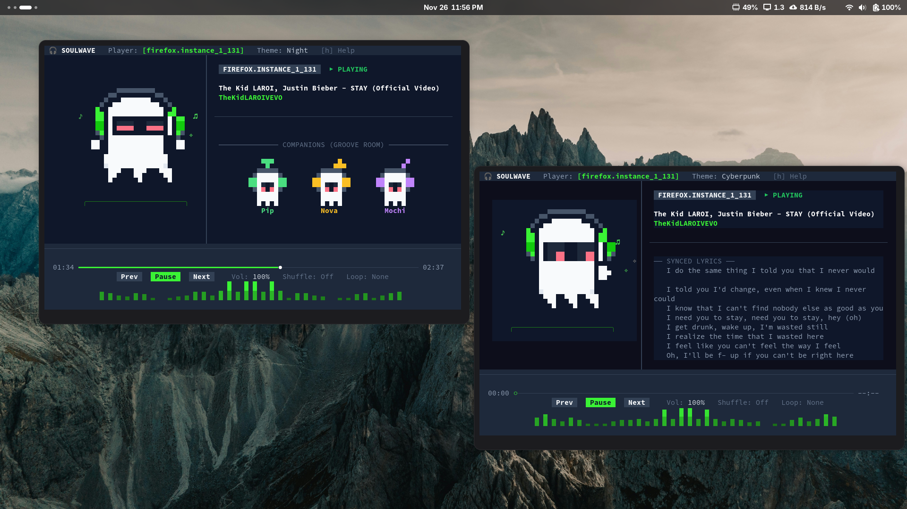
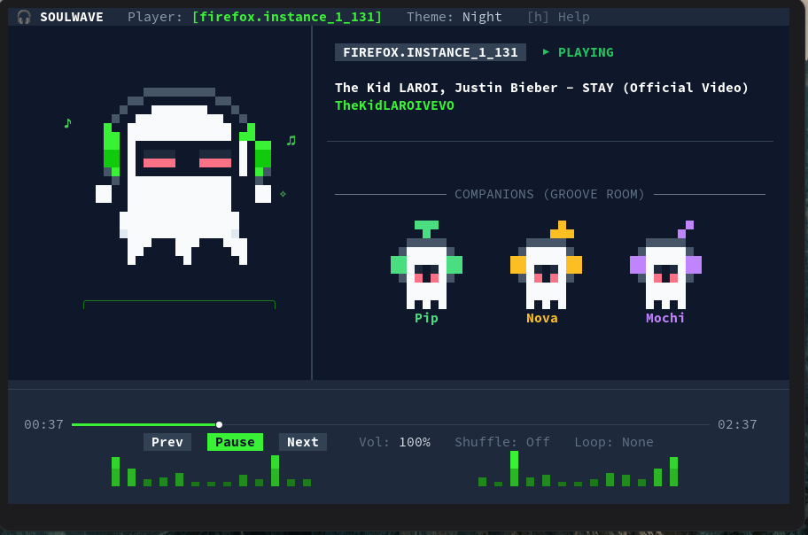
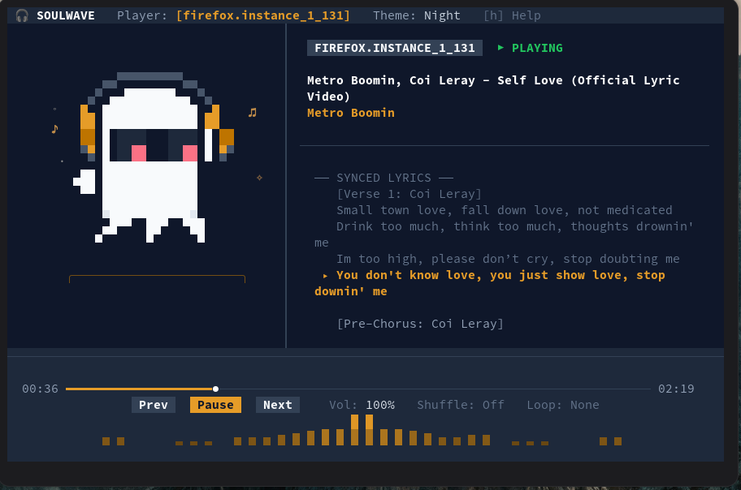

# SoulWave

```
             ✧                        
                   ✦                
             ▄▄▀▀▀▀▀▀▄▄             
           ▄▀ ▄▀▀▀▀▀▀▄ ▀▄           
           ▀  ▀ ▀  ▀ ▀  ▀           
            ▀ ▀▄▀▄ ▀▄▀ ▀            
              ▀▀▀▀▀▀▀▀            ✧ 
  ✧           ▀▀▀▀▀▀▀▀              
        ˚     ▄▀ ▀  ▀▄              
       ♬                            
```

> **A retro-futuristic terminal music controller featuring grooving pixel-art soul companions, synchronized scrolling lyrics, real-time CAVA spectrum visualization, and universal MPRIS support.**

[](LICENSE)
[](https://kernel.org)
[](https://github.com/AquaA1/SoulWave/releases)
[](packaging/rpm/)
[](https://www.python.org/)
[](https://github.com/AquaA1/SoulWave/actions/workflows/release.yml)

---

## 📸 Screenshots

<p align="center">
  
  <br/>
  <em>Dual desktop setup featuring SoulWave in <strong>Night</strong> (left) and <strong>Cyberpunk</strong> (right) themes, with live companion mascots, active MPRIS tracking, and real-time CAVA spectrum visualizer.</em>
</p>

<p align="center">
  
  
</p>
<p align="center">
  <em><strong>Left:</strong> Groove Room with soul companions <strong>Pip</strong>, <strong>Nova</strong>, and <strong>Mochi</strong> jamming to the beat. <br/>
  <strong>Right:</strong> Live synchronized lyrics engine scrolling with timestamp highlighting and theme-adaptive coloring.</em>
</p>

---

## 🌟 Highlights

- 🎧 **Universal MPRIS Controller**: Seamlessly binds to **Spotify, Firefox, Chrome, Brave, MPV, VLC**, or any player implementing the Linux MPRIS2 D-Bus interface.
- 👾 **Grooving Soul Companions**: Handcrafted pixel-art mascots (*Pip, Nova, Mochi*) dancing rhythmically with state-driven easing and pause transitions.
- 📜 **Real-Time Synchronized Lyrics**: Automatic `.lrc` lyric retrieval via LRCLIB with autoscroll, active-line highlighting, local caching, and manual offset tuning (<kbd>[</kbd>/<kbd>]</kbd>).
- 📊 **Dynamic Audio Spectrum Visualizer**: 16-bar responsive visualizer connected via CAVA FIFO with smooth pause decay and procedural harmonic wave fallback.
- 🖱️ **Timeline & Mouse Seek**: Sub-second wall-clock interpolation for liquid-smooth progress tracking and direct mouse click-to-seek timeline support.
- 🎨 **Theme Engine & Mini Mode**: 6 built-in palettes (*Night, Sunset, Mint, Sakura, Cyberpunk, Mono*), dynamic accent matching, and an ultra-compact single-line widget (<kbd>m</kbd>).
- 🩺 **Built-In Doctor & Interactive Assistant**: Guided setup installer with hardware diagnostics and `soulwave --doctor` system verification.

---

## 🚀 Quick Start

### One-Liner Install (Universal Standalone Binary)

Install SoulWave on **Ubuntu, Debian, Fedora, Arch Linux, Linux Mint, Pop!_OS, openSUSE**, or any modern Linux distribution with a single command:

```bash
curl -fsSL https://raw.githubusercontent.com/AquaA1/SoulWave/main/install.sh | bash
```

- **Zero Python Setup Required**: Installs a standalone, self-contained binary into `~/.local/bin/soulwave`. No virtual environments, pip packages, or Python version conflicts.
- **Rootless & Safe**: Does not require `sudo`. Every release asset is verified against SHA-256 checksums before installation.
- **Pre-Flight Diagnostics**: Inspects your environment, terminal color support, D-Bus session bus, and audio backends automatically.

> [!TIP]
> Ensure `~/.local/bin` is in your `$PATH`. If not already present, add it:
> ```bash
> echo 'export PATH="$HOME/.local/bin:$PATH"' >> ~/.bashrc && source ~/.bashrc
> ```

### Recommended Audio Utilities

SoulWave includes a built-in demo mode and procedural harmonic waveforms, but installing `playerctl` and `cava` enables full desktop media tracking and hardware audio visualization:

| Distribution | Package Manager Command |
|---|---|
| **Fedora / RHEL** | `sudo dnf install playerctl cava` |
| **Ubuntu / Debian / Mint / Pop!_OS** | `sudo apt update && sudo apt install playerctl cava` |
| **Arch Linux / Manjaro** | `sudo pacman -S playerctl cava` |
| **openSUSE** | `sudo zypper install playerctl cava` |

---

## 📦 Alternative Installation Methods

<details>
<summary><strong>Fedora / RHEL (Native RPM)</strong></summary>

```bash
# Automated via installer:
curl -fsSL https://raw.githubusercontent.com/AquaA1/SoulWave/main/install.sh | bash -s -- --rpm

# Or direct manual install:
sudo dnf install ./soulwave-*.rpm
```
</details>

<details>
<summary><strong>Python Wheel (pip / pipx)</strong></summary>

```bash
# Using pipx (recommended for Python CLI apps):
pipx install soulwave

# Or via the installer script:
curl -fsSL https://raw.githubusercontent.com/AquaA1/SoulWave/main/install.sh | bash -s -- --wheel
```
</details>

<details>
<summary><strong>System-Wide Installation (/usr/local/bin)</strong></summary>

```bash
curl -fsSL https://raw.githubusercontent.com/AquaA1/SoulWave/main/install.sh | bash -s -- --system
```
</details>

<details>
<summary><strong>Repair or Reinstall</strong></summary>

If your environment or binary was corrupted:
```bash
curl -fsSL https://raw.githubusercontent.com/AquaA1/SoulWave/main/install.sh | bash -s -- --repair
```
</details>

<details>
<summary><strong>Uninstallation</strong></summary>

Cleanly removes the binary or packages while preserving your personal settings in `~/.config/soulwave`:
```bash
curl -fsSL https://raw.githubusercontent.com/AquaA1/SoulWave/main/install.sh | bash -s -- --uninstall
```
</details>

---

## 🎮 Usage & CLI Options

```bash
# Launch SoulWave
soulwave

# Explore without an active player using built-in lo-fi tracks
soulwave --demo

# Launch in ultra-compact Mini Mode (single-line widget)
soulwave --mini

# Start with a specific theme (night, sunset, mint, sakura, cyberpunk, mono)
soulwave --theme cyberpunk

# Lock tracking to a specific player
soulwave --player spotify

# Run comprehensive system diagnostics
soulwave --doctor

# Quick installation health check
soulwave --check
```

---

## ⌨️ Keybindings

| Key | Action |
|:---:|:---|
| <kbd>Space</kbd> | Toggle Play / Pause |
| <kbd>n</kbd> / <kbd>p</kbd> | Next / Previous track |
| <kbd>→</kbd> / <kbd>←</kbd> | Seek forward / backward (5 seconds) |
| <kbd>↑</kbd> / <kbd>↓</kbd> or <kbd>+</kbd> / <kbd>-</kbd> | Volume up / down (5%) |
| <kbd>s</kbd> | Toggle shuffle mode |
| <kbd>r</kbd> | Cycle repeat mode (*Off → Track → Playlist*) |
| <kbd>Tab</kbd> | Cycle active player (*Spotify, Firefox, Chrome, MPV, etc.*) |
| <kbd>l</kbd> | Toggle synchronized lyrics panel |
| <kbd>v</kbd> | Toggle CAVA audio spectrum visualizer |
| <kbd>t</kbd> | Cycle color themes |
| <kbd>m</kbd> | Toggle ultra-compact Mini mode |
| <kbd>[</kbd> / <kbd>]</kbd> | Adjust lyric synchronization offset (±100ms) |
| <kbd>q</kbd> | Quit SoulWave |
| **Mouse Click** | Click anywhere along the timeline bar to seek directly to that timestamp |

---

## ⚙️ Configuration

SoulWave automatically generates its configuration file at `~/.config/soulwave/config.toml`:

```toml
[app]
theme = "night"              # Options: night, sunset, mint, sakura, cyberpunk, mono
show_lyrics = true          # Open lyrics panel on launch
show_visualizer = true      # Enable audio spectrum visualizer
mini_mode = false           # Launch directly in single-line compact mode
default_player = "spotify"  # Preferred MPRIS player name
fps = 12                    # Animation tick rate (frames per second)

[visualizer]
bars = 16                   # Number of frequency spectrum bars
sensitivity = 100           # CAVA audio sensitivity percentage

[lyrics]
cache_enabled = true        # Cache downloaded .lrc files in ~/.cache/soulwave
auto_scroll = true          # Smoothly scroll and center active line
```

---

## 🛠️ Architecture & Developer Guide

SoulWave is engineered as a modern, reactive terminal application using [Textual](https://textual.textualize.io/) and [Rich](https://rich.readthedocs.io/).

```
                          ┌───────────────────────────┐
                          │   SoulWave UI (Textual)   │
                          └─────────────┬─────────────┘
                                        │
           ┌────────────────────────────┼───────────────────────────┐
           ▼                            ▼                           ▼
┌─────────────────────┐      ┌─────────────────────┐     ┌─────────────────────┐
│    Player Engine    │      │    Lyrics Engine    │     │  Visualizer Engine  │
├─────────────────────┤      ├─────────────────────┤     ├─────────────────────┤
│ • MPRIS2 D-Bus      │      │ • LRCLIB API Client │     │ • CAVA FIFO Reader  │
│ • playerctl Poll    │      │ • LRC Parser        │     │ • Decay Smoothing   │
│ • Sub-sec Interp.   │      │ • Local Disk Cache  │     │ • Procedural Waves  │
└─────────────────────┘      └─────────────────────┘     └─────────────────────┘
           │                            │                           │
           └────────────────────────────┼───────────────────────────┘
                                        ▼
                          ┌───────────────────────────┐
                          │  Mascot Animation Engine  │
                          │   (Pip, Nova, Mochi)      │
                          └───────────────────────────┘
```

### Module Breakdown

| Package | Responsibility |
|---|---|
| `soulwave/player/` | **Playback & MPRIS Abstraction**: `mpris.py` monitors D-Bus `org.mpris.MediaPlayer2` and signals like `NameOwnerChanged`. `interpolator.py` computes sub-second wall-clock progress to avoid erratic polling. `manager.py` handles auto-discovery and reconnecting. `mock_player.py` drives demo mode. |
| `soulwave/lyrics/` | **Lyric Synchronization**: `client.py` interfaces with LRCLIB, `parser.py` parses timestamps into milliseconds, and `cache.py` caches lyrics locally to reduce network requests. |
| `soulwave/audio/` | **Audio Visualization**: `cava_reader.py` reads raw 16-bar byte streams from a temporary CAVA FIFO. `visualizer.py` provides smooth decay damping during pauses and harmonic fallback synthesis. |
| `soulwave/mascot/` | **Pixel-Art Sprite Engine**: `frames.py` houses ASCII/half-block pixel matrices. `animator.py` manages frame timers, state easing, and companion synchronization. `scene.py` orchestrates multi-character layouts. |
| `soulwave/ui/` | **Reactive Widgets & Styles**: Textual app implementation (`app.py`), styling (`styles.tcss`), and reactive components (`now_playing.py`, `progress_bar.py`, `lyrics_panel.py`, `companion_view.py`, `visualizer.py`). |
| `soulwave/theme/` | **Color Systems**: Curated aesthetic palettes (`palettes.py`) and dynamic track accent extraction (`dynamic.py`). |
| `soulwave/cli.py` | **CLI & Diagnostics**: Argument parsing, `--doctor` system environment audit, and quick verification checks. |

---

### Local Development Setup

To contribute or hack on SoulWave locally:

1. **Clone the repository**:
   ```bash
   git clone https://github.com/AquaA1/SoulWave.git
   cd SoulWave
   ```

2. **Create a virtual environment & install dependencies**:
   ```bash
   python3 -m venv .venv
   source .venv/bin/activate
   pip install -e ".[dev]"
   ```

3. **Run SoulWave in development mode**:
   ```bash
   # Run with live local changes
   python3 -m soulwave --demo

   # Or test against an active MPRIS player
   python3 -m soulwave
   ```

4. **Run the automated test suite**:
   ```bash
   pytest tests/ -v
   ```

---

## 🔍 Troubleshooting & Diagnostics

### Run the System Doctor
If audio visualization or player detection is not behaving as expected, run:
```bash
soulwave --doctor
```
This inspects:
- Python environment and required packages (`textual`, `rich`, `requests`, `syncedlyrics`).
- D-Bus session bus connectivity and active MPRIS services.
- `playerctl` binary availability.
- `cava` binary availability and audio server status (PipeWire / PulseAudio).
- Stylesheet assets and local user configuration/cache paths.

### Flatpak Player Permissions
If using Spotify or other media players installed via Flatpak, grant D-Bus permissions so MPRIS signals can be read:
```bash
flatpak override --user --talk-name=org.mpris.MediaPlayer2.spotify com.spotify.Client
```

---

## 💖 Credits & Acknowledgements

- **[CAVA](https://github.com/karlstav/cava)** – Console-based Audio Visualizer by Karl Stavestrand.
- **[Textual](https://github.com/Textualize/textual)** & **[Rich](https://github.com/Textualize/rich)** – Rapid TUI development framework and rich text formatting.
- **[LRCLIB](https://lrclib.net)** – Community-driven synchronized lyrics service.
- **[playerctl](https://github.com/altdesktop/playerctl)** – MPRIS command-line tool and discovery library.

---

## 📄 License

This project is licensed under the [MIT License](LICENSE). Built and maintained with passion for retro-futuristic terminal aesthetics.
